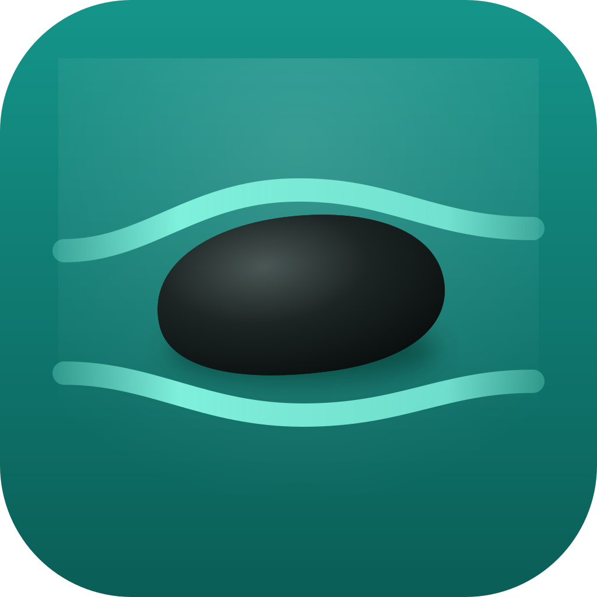

# Sela

Website and download: https://dotdeon.github.io/sela

Sela is a free, open-source Mac browser with a calm sidebar. Favourites sit at the top, then pinned tabs and folders, then today's tabs, and you swipe between spaces. Tabs you don't pin archive themselves, so the sidebar never fills up. It runs on WebKit, the engine Safari uses, with a native Swift interface on top. The design lives in [`docs/design/2026-10-23-sela-design.md`](docs/design/2026-10-23-sela-design.md).

What it does today:

- **Sidebar and spaces.** Favourites, pinned tabs and folders, and today's tabs, in spaces you swipe between. Unpinned tabs archive themselves after 12 hours and stay findable for 30 days.
- **Command bar.** Cmd+T and Cmd+L search open tabs, favourites, pinned tabs inside folders, archived tabs, history and commands. A tab in a folder shows the folder it sits in, and choosing it opens that folder in the sidebar.
- **Split view and Peek.** Up to four tabs side by side. Links from pinned tabs and favourites to other sites open in Peek, a preview over the page.
- **Profiles.** Each space can have its own profile, with its own cookies, logins, site data and cache, so a Work space and a Personal space can be signed in to different accounts at once. Choose or make one from a space's menu. Favourites, history and archived tabs are shared.
- **Little Sela.** Links from other apps open in a small window of their own. Open in Sela moves the page to your tabs without reloading it, and Cmd+Shift+N opens an empty one.
- **Ad and tracker blocking.** AdGuard Base and EasyPrivacy, YouTube's video ads included, with a switch per site.
- **Extensions.** On macOS 15.4 or later Sela runs Web Extensions, the kind Safari and Chrome use. Add them in Settings from a folder or a .zip file, and their buttons sit at the top of the sidebar. Sela can't install from the Chrome Web Store.
- **Reader mode.** When a page looks like an article, a button at the end of the address shows it in a quiet serif layout that follows light and dark mode. View > Reader (Cmd+Shift+R) turns it on and off.
- **Tab sleep.** Tabs you haven't looked at for 15 minutes sleep to save memory, and wake where they were.
- **The basics.** Downloads, find on page (Cmd+F), file uploads, and a prompt before a site uses your camera or microphone.
- **Moving in.** On first launch Sela offers to bring in your sidebar and the last 90 days of history from Arc.
- **Updates.** Sela checks for new versions once a day, downloads them in the background, and installs them the next time you quit.

Settings (Cmd+,) holds the default browser, search engine, where links from other apps open, tab sleep, archiving, ad blocking, extensions, profiles and site permission choices. The repository also holds a tool that backs up your Arc data.

## Folder layout

```
assets/        Sela's own icons and artwork
docs/design/   design documents
docs/plans/    implementation plans
app/Sela/      the Mac app: windows, menus and first-launch import
app/Sela.xcodeproj  Xcode project that builds Sela.app
app/Support/   the app's Info.plist
app/Packages/  Swift package with one module per feature
scripts/       release and measuring scripts
```

Inside `app/Packages`:

- `SidebarModel`: spaces, their profiles, tabs, folders and favourites, and how they're saved to disk
- `ArcImport`: reads Arc's `StorableSidebar.json` into Sela's sidebar
- `ArcSnapshot`: copies Arc's data folder, minus caches, so it survives Arc shutting down
- `sela-arc`: command-line tool for the two above
- `BrowserEngine`: the protocols Sela's UI uses to talk to a browser engine
- `WebKitEngine`: those protocols built on Safari's WebKit
- `FakeEngine`: a stand-in engine with no web content, for tests
- `Browsing`: a window's live tabs on top of the sidebar, popups, page dialogs, address bar parsing, and Little Sela windows
- `Sidebar`: the shared sidebar store that saves itself, plus outline, drag and drop, and swipe logic
- `SidebarUI`: the sidebar's views: favourites grid, space pages, space bar and address
- `Favicons`: site icons, fetched from each site and cached on disk
- `Archive`: closed and inactive unpinned tabs, kept 30 days so they can be found and reopened
- `History`: pages you've visited, kept 90 days in a SQLite file on your Mac
- `CommandBar`: the Cmd+T and Cmd+L command bar: ranking and the panel
- `Downloads`: this session's downloads and how downloaded files are named
- `Extensions`: the Web Extensions you installed, copied into Sela's data folder, which ones are on, and the permissions you gave them
- `ContentBlocking`: ad and tracker blocking: downloads the filter lists, converts them with AdGuard's converter, and keeps the per-site settings
- `SelaTestSupport`: sample sidebars shared by the tests

## Download

[Download Sela](https://github.com/DotDeon/sela/releases/latest/download/Sela.dmg), open the disk image and drag Sela to Applications. Every build is signed and notarized, and all of them are on the [releases page](https://github.com/DotDeon/sela/releases). Sela needs macOS 15 or later.

## Running Sela

You need Xcode 27.

```bash
xcodebuild -project app/Sela.xcodeproj -scheme Sela -configuration Debug -derivedDataPath .build/xcode -skipPackagePluginValidation build
open .build/xcode/Build/Products/Debug/Sela.app
```

`-skipPackagePluginValidation` lets AdGuard's SafariConverterLib run its build plugin, which only writes the library's version number into its source.

Sela is signed ad hoc by default. To sign it with your own Apple team, copy `app/Support/Signing.local.xcconfig.example` to `app/Support/Signing.local.xcconfig` and fill in your team ID and profile name. Git ignores that file.

You can also open `app/Sela.xcodeproj` in Xcode and press Cmd+R. The first time, Xcode asks you to trust the `GenerateVersion` plugin from `safariconverterlib`.

To measure how much memory Sela uses with 10 real sites open, before and after tabs sleep, quit Sela, Safari and Mail and run `scripts/measure-memory.sh`. It uses a throwaway profile, so your sidebar isn't touched.

To release, run `scripts/ship.sh 0.1.4` on main. It sets the version, tags it and pushes, and the Release workflow on GitHub builds, signs and notarizes Sela, then publishes the disk image, the zip Sparkle updates from, delta updates from the last version and the signed update feed, `appcast.xml`. The workflow's header lists the secrets it needs. To build a release on your own Mac instead, run `scripts/release.sh TEAM_ID`. It needs a Developer ID Application certificate, the `asc` command-line tool logged in to App Store Connect, the `gh` tool logged in to GitHub, and Sela's update signing key in your login keychain.

## Running the tests

```bash
swift test --package-path app/Packages
```

## Backing up and checking your Arc data

Quit Arc, then copy its data to a folder of your choice, ideally an external drive:

```bash
swift run --package-path app/Packages sela-arc snapshot "/Volumes/Backup"
```

This creates a folder named `Arc-snapshot-<date>`. It refuses to run while Arc is open, because copying Arc's databases while Arc writes to them gives a broken copy.

The snapshot can't recover your saved passwords on another Mac, because Arc encrypts them with a key that stays in this Mac's keychain. Export your passwords to a CSV file from Arc's password settings before Arc shuts down.

To see what Sela would import from your live Arc data or from a snapshot:

```bash
swift run --package-path app/Packages sela-arc inspect
swift run --package-path app/Packages sela-arc inspect --root "/Volumes/Backup/Arc-snapshot-<date>"
```

Neither command changes anything in Arc's folder.

## Supporting Sela

Sela is free and has no ads. If it helps you, you can sponsor its development on [GitHub Sponsors](https://github.com/sponsors/DotDeon).

## Licence

Sela is free software under the GNU General Public License, version 3. See [`LICENSE`](LICENSE).

## Third-party code

- [Sparkle](https://sparkle-project.org) (MIT) checks for and installs updates.
- [SafariConverterLib](https://github.com/AdguardTeam/SafariConverterLib) by AdGuard (GPL-3.0) converts ad blocking filter lists into WebKit's content blocking rules.
- [@adguard/safari-extension](https://github.com/AdguardTeam/SafariConverterLib/tree/master/Extension), [@adguard/extended-css](https://github.com/AdguardTeam/ExtendedCss) and [@adguard/scriptlets](https://github.com/AdguardTeam/Scriptlets) by AdGuard (GPL-3.0) apply the rules WebKit can't, inside each page.
- [PunycodeSwift](https://github.com/gumob/PunycodeSwift) (MIT) and [swift-psl](https://github.com/ameshkov/swift-psl) (MIT) come with SafariConverterLib.
- [AdGuard Base](https://github.com/AdguardTeam/AdguardFilters) (GPL-3.0) and [EasyPrivacy](https://easylist.to) (GPL-3.0 or CC BY-SA 3.0) are downloaded at run time, not shipped with Sela.
